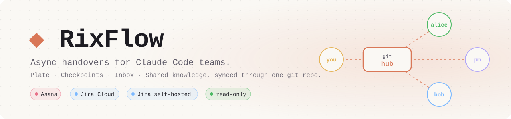
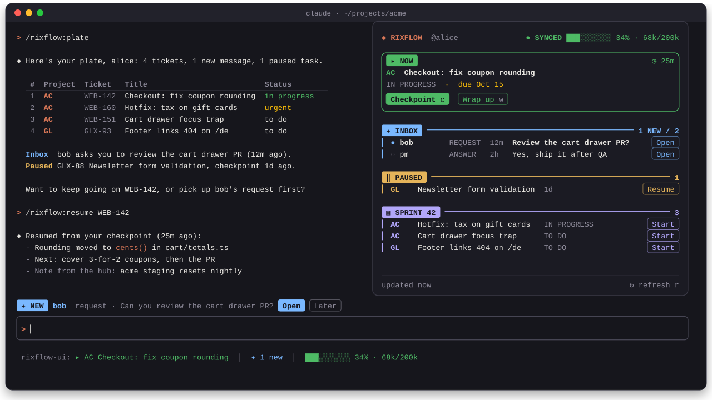
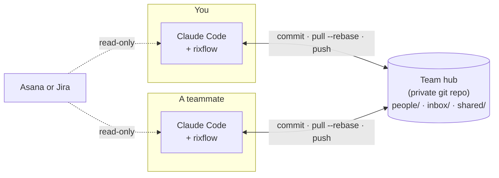
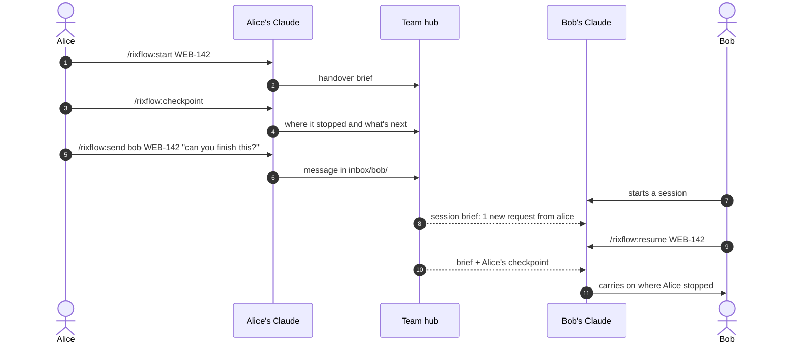
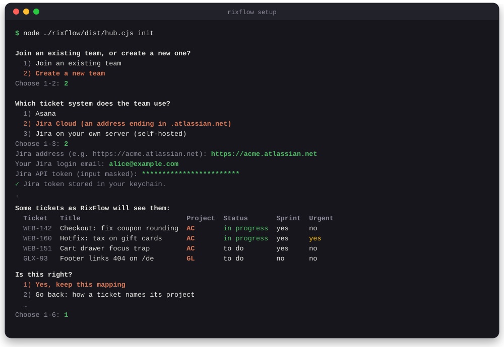

<p align="center">
  <picture>
    <source media="(prefers-color-scheme: dark)" srcset="assets/banner-dark.svg">
    
  </picture>
</p>

<p align="center">
  <a href="LICENSE"></a>
  <a href="package.json"></a>
  <a href="https://claude.com/claude-code"></a>
  <a href="https://modelcontextprotocol.io"></a>
  
  
</p>

Async team workflow for [Claude Code](https://claude.com/claude-code). Each teammate's Claude shares one git **hub** repo with the rest of the team, so work moves between people without meetings: pause a task with a checkpoint, and you (or a teammate) can pick it up tomorrow exactly where it stopped.

<p align="center">
  
</p>

<table>
  <tr>
    <td width="50%" valign="top"><b>🍽️ Plate</b><br>Your tickets (Asana, or Jira Cloud or self-hosted), inbox and paused work in one list.</td>
    <td width="50%" valign="top"><b>🤝 Handovers</b><br>Start a task with a brief, pause it with a checkpoint, and pick it up later (or let someone else).</td>
  </tr>
  <tr>
    <td valign="top"><b>📨 Inbox</b><br>Send requests and questions to a teammate's Claude; it sees them at its next session.</td>
    <td valign="top"><b>📚 Shared knowledge</b><br>Searchable notes per project, promoted from sessions.</td>
  </tr>
  <tr>
    <td valign="top"><b>🖥️ RixFlow UI</b><br>A status line, a band above the prompt and a <code>RixFlow</code> pane that show all of the above live, with no model calls.</td>
    <td valign="top"><b>🔒 Safe by design</b><br>Your ticket system is <b>read-only</b>, and every string written to the hub passes through a secret scrubber first.</td>
  </tr>
</table>

## Table of contents

- [How it works](#how-it-works)
- [Installation](#installation)
- [First-time setup](#first-time-setup)
- [Usage](#usage)
- [Updating](#updating)
- [Development](#development)
- [License](#license)

## How it works



A typical handover:



- Everything is plain Markdown in a git repo that your team owns. RixFlow commits and syncs it for you (pull --rebase with bounded push retries).
- Each person writes only to their own folder. They may drop new messages into someone else's inbox but never edit them. A pre-commit check in the hub enforces this.
- Hooks brief Claude at session start ("2 new requests from pm…") and write a short session summary when a session ends.

## Installation

Two plugins ship from this repository:

| Plugin | What it is |
| --- | --- |
| `rixflow` | The core: slash commands, a stdio MCP server and session hooks. |
| `rixflow-ui` | The live UI (status line, band, pane). It makes no model calls, so it costs no tokens. Installing it also installs `rixflow`. |

### Claude Code

Register the marketplace, then install:

```
/plugin marketplace add hnikoloski/rixflow
/plugin install rixflow-ui@rixflow
```

To get the core without the UI:

```
/plugin install rixflow@rixflow
```

Then run [first-time setup](#first-time-setup).

### From a local clone

```sh
git clone https://github.com/hnikoloski/rixflow.git && cd rixflow
claude plugin marketplace add ./
claude plugin install rixflow-ui@rixflow
```

### OpenCode and other MCP clients

The plugin format is Claude Code's own, but the core is a plain CLI plus a stdio MCP server. Wire the server into `opencode.json`:

```json
{ "mcp": { "hub": { "type": "local", "command": ["node", "plugin/dist/mcp.cjs"] } } }
```

Set `RIXFLOW_DIR` (the hub clone) and `RIXFLOW_CONFIG_DIR` (this machine's config) yourself. See [`AGENTS.md`](AGENTS.md#running-outside-claude-code-opencode).

## First-time setup

In Claude Code, run:

```
/rixflow:setup
```

It prints the exact `init` command for your machine. Run that command **in your own terminal**: it opens a guided setup.

<p align="center">
  
</p>
 On a fresh machine you choose to **join** a team or **create** one; once the machine is set up, the same command opens a **change** menu. The hub URL must work without a password prompt (ssh-agent for ssh, a credential helper for https).

### Join an existing team

Choose "join". The wizard clones the team's hub, asks for your name and projects folder, then connects your own ticket account: a personal access token for Asana, your login email plus an API token for Jira Cloud, or a personal access token for self-hosted Jira. Tokens are typed as masked input (one `*` per character) and stored in the system keychain, or a `0600` file. The wizard then installs the hub's pre-commit check. A team whose setup needs a newer RixFlow tells you to update first.

This machine remembers the Jira address it connected to and sends your Jira token only there. If the hub's `workflow.yml` later names another address, RixFlow stops using the token and the session brief says so. Run setup and choose "Reconnect my ticket account" if the change is expected.

### Create a team

Choose "create". The wizard connects your ticket system (Asana, or Jira Cloud or self-hosted), asks for the team's projects and teammates, and maps your tickets to those projects, statuses, sprints and urgency. It then creates the hub, pushes it to the private git repository you give it (or one it creates with the GitHub CLI), and prints what to share with teammates.

With Asana, the wizard samples projects from the tasks assigned to you. A team project you are not assigned to will not appear as a mapping value until someone redoes the mapping (change menu, "Redo the ticket mapping").

The hub must be private. Setup refuses a hub repository anyone can read, and the session brief warns while the hub is public. Set `RIXFLOW_ALLOW_PUBLIC_HUB=1` to continue anyway, with a warning.

Restricted tickets (Jira tickets with a security level) stay off the hub: the handover keeps only the ID, title and your own notes. Their description and comments go to a private file on your machine.

### Change the setup

Run the same command again on a set-up machine. The menu offers: add or remove a teammate, add a project, rename or move a project, redo the ticket mapping, reconnect your ticket account, or start over on this machine. Each change to the team's setup is one commit, synced like any other hub write. Removing a project and switching ticket systems are deliberately not offered.

### The workflow file

The team's ticket mapping lives in the hub as `config/workflow.yml`, written by the wizard. For example, for Jira:

```yaml
requires: 0.3.0
tracker: { type: jira, url: https://acme.atlassian.net, flavor: cloud, projects: [WEB] }
project: { from: component, values: { Storefront: AC } }
status: { field: null, todo: [To Do], in_progress: [In Progress], waiting: [Blocked], done: [Done] }
sprints: { mode: jira-sprints, board: null }
urgent: { field: Priority, values: [Highest] }
```

`requires` is the lowest RixFlow version that understands the file; an older RixFlow skips the ticket features and says so. Hubs without a `workflow.yml` keep the original Asana mapping.

Advanced: `node plugin/dist/hub.cjs bootstrap ./my-team-hub --members alice:dev,bob:pm --sites AC:acme,GL:globex-web` creates a hub non-interactively. `--sites` maps short project codes to project folder names, so a ticket tagged `AC` opens in `~/projects/acme`.

## Usage

| Command | What it does |
| --- | --- |
| `/rixflow:plate` | Everything on your plate: tickets, inbox, paused work |
| `/rixflow:start <ticket id or plate number>` | Start a ticket with a handover brief |
| `/rixflow:checkpoint [task id]` | Pause the current task and save where you left off |
| `/rixflow:resume <task id>` | Resume a task from its handover and checkpoint |
| `/rixflow:wrapup [task id]` | Finish the task and capture what the team should know |
| `/rixflow:inbox [message id]` | Show your inbox, or open one message |
| `/rixflow:send <person> <task id> [note]` | Send a teammate's Claude a request about a task |
| `/rixflow:ask [person] <question>` | Search the hub first, then ask a teammate |
| `/rixflow:setup` | Show how to set up this machine |
| `/rixflow-ui [refresh]` | Toggle the RixFlow pane, or refresh it now |

The UI runs only in interactive terminal sessions. With the pane focused, `c` checkpoints, `w` wraps up and `r` refreshes.

## Updating

```
/plugin marketplace update rixflow
```

This refreshes the marketplace and updates both installed plugins. Restart Claude Code afterwards. Updates only pick up a new **version**. If you're working from a local clone without bumping the version, reinstall instead.

## Development

Requires **Node 20+** and **git** on PATH (the tests build real temporary repos).

```sh
git clone https://github.com/hnikoloski/rixflow.git && cd rixflow
npm install
npm run check        # typecheck + tests + build, and fails if plugin/dist is stale
```

| Command | Purpose |
| --- | --- |
| `npm test` | All tests (Vitest) |
| `npx vitest run tests/core/scrub.test.ts` | One test file |
| `npm run typecheck` | Strict `tsc` |
| `npm run build` | Bundle `src/` into `plugin/dist/*.cjs`. The bundles are committed and are what runs, so rebuild after any `src/` change. |
| `claude --plugin-dir ui` | Run the UI mod straight from this checkout |
| `claude plugin validate ui && claude plugin test ui` | Validate the mod and run its kit tests |

[`AGENTS.md`](AGENTS.md) is the contributor guide. It covers the layout, the rules the code enforces (read-only ticket clients, scrubbing, hooks that never fail a session) and conventions.

## License

[MIT](LICENSE). The bundles in `plugin/dist/` include third-party packages under their own licenses (MIT and ISC): `@modelcontextprotocol/sdk`, `commander`, `yaml` and `zod`.
